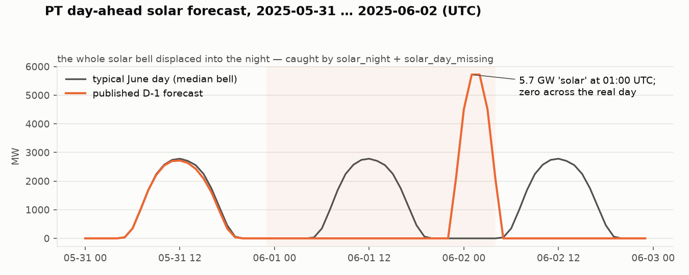
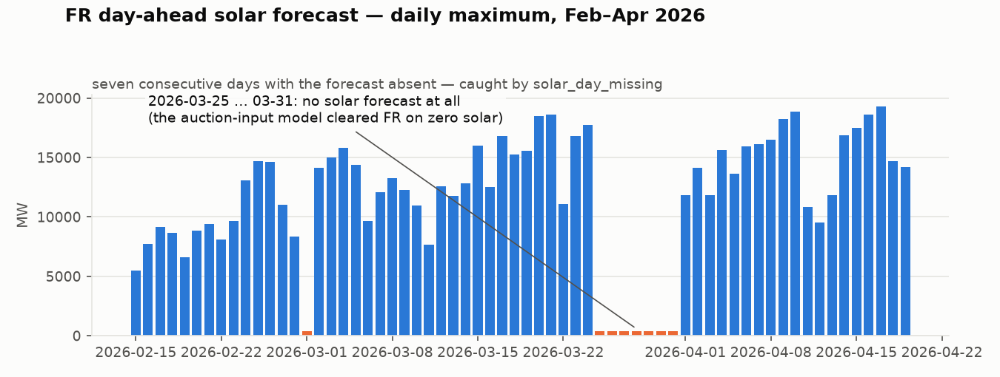
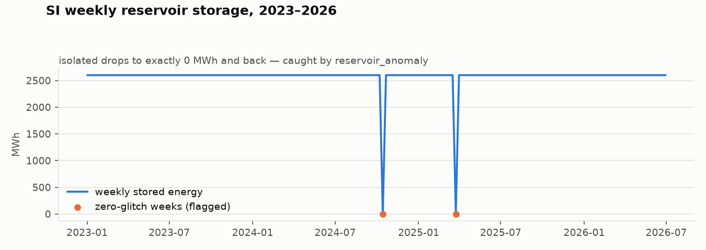
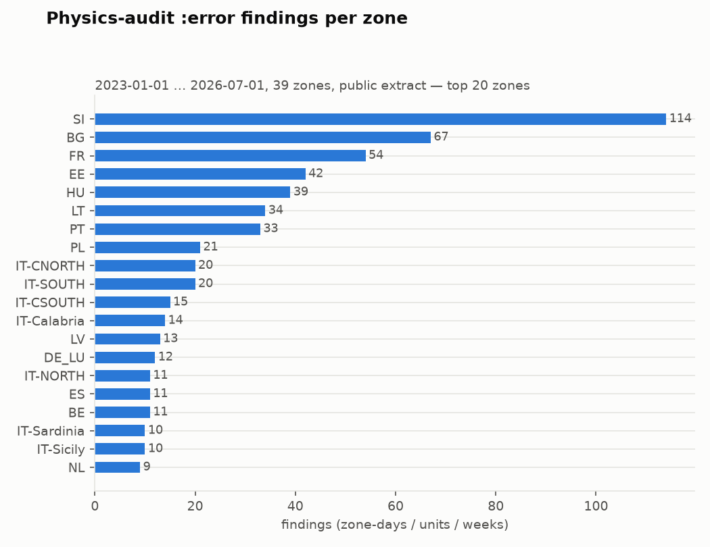

# Physics-consistency audit of the ENTSO-E ingest (October 2026)

**What.** A read-only audit layer over the ingested ENTSO-E data
(`src/db/physics_audit.jl`, runner `bin/physics_audit.jl`, daily CI step in
`refresh-extract.yml`): eleven checks, each a **physical invariant the data
cannot violate if it is right** — PV produces nothing when the sun is below
the horizon, a bidding zone's demand never collapses to near zero, a unit
cannot out-produce its nameplate by 2×, a seasonal reservoir cannot cycle 30%
of its storage in a week, a UTC delivery day has 24 hours, one quantity has
one market-time-unit per day.

**Why.** Every data-corruption incident in the ledger so far was found
*reactively*, after it had fed order books, and each got its own point defense
in the reading code: the 13,068,005 MW IT-CSOUTH registry row
(cv24 → `MAX_PLAUSIBLE_UNIT_MW`), the FR 2026-01-08 mixed 15/60-min RES rows
and the dropped RES NULLs (cv33), the SI/BE days missing D-1 load-forecast
hours that collapsed the coupled 39-zone intersection (cv25), the
intraday-contaminated phantom ATC (cv26). The auction clears on these inputs
— the demand book is ~98% of the load forecast, RES bids the D-1 forecast at
€1 — so a corrupt input day produces a garbage counterfactual price that is
indistinguishable, downstream, from a conduct signal. This layer turns the
incident class from reactive to proactive, at refresh time.

**Deliberately NOT a model change.** No clearing-path behavior changes; the
audit only reads and reports. The ex-ante rule does not apply to its baselines
(historical quantiles, climatologies) because nothing here feeds the model.

## Coverage — what actually ran

- **Historical arm:** the full public extract `euphemia-data-v1.1`
  (2023-01-01 … 2026-07-01, 39 zones; ~1,277 days, ≈ 90M rows across the
  seven audited tables). Runtime **15 s** on the DuckDB extract.
- **Live arm:** the live Postgres, trailing-14-day window
  (2026-10-08 … 2026-10-24), the exact shape of the daily CI step — proves
  the same SQL runs on both backends and that the audit sees *today's* ingest.

## Replay of ledgered incidents (known positives)

| Ledgered incident | Check | Caught? |
|---|---|---|
| IT-CSOUTH 13,068,005 MW registry rows (cv24) | `registry_bounds` | ✅ all 3 rows, the only `:error`s in the extract registry |
| FR 2026-01-08 mixed PT15M/PT60M RES rows (cv33) | `resolution_mix` | ✅ (plus FR 01-06/07 — the seam was 3 days wide) |
| SI/BE/BG days missing D-1 load-forecast hours (cv25) | `load_day_incomplete` | ✅ **exactly** the ledgered counts: SI 48, BE 8, BG 4 |
| ES 2026-06-11 cleared with no RES (cv33) | `solar_day_missing` | ✅ (solar half; a wind analogue is future work) |

Out of scope by design: the cv26 phantom-ATC incident is a *reader-semantics*
defect (intraday rows blended into Day-ahead), not a violation of a physical
invariant of the stored rows — it stays with the cv26 read-time defense.

## What the audit found (full extract, 2023-01 … 2026-07)

1,374 findings; `:error` = physically impossible and feeds the model,
`:warn` = implausible / review queue, `:info` = context.

| check | severity | findings | zones | flagged units (hours/days/weeks) |
|---|---|---|---|---|
| `solar_day_missing` | error | 236 | 26 | 236 zone-days |
| `solar_night` | error | 137 | 16 | 244 zone-hours |
| `load_day_incomplete` | error | 75 | 11 | 867 missing hours |
| `reservoir_anomaly` | error | 68 | 8 | 68 zone-weeks |
| `unit_output_above_capacity` | error (≥2× cap) | 65 | 11 | 7,725 unit-hours |
| `load_bounds` | error | 39 | 6 | 226 zone-hours |
| `registry_bounds` | error (>25 GW) | 3 | 1 | the IT-CSOUTH rows |
| `solar_night` | warn | 434 | 19 | 448 zone-hours |
| `registry_bounds` | warn (cap ≤ 0) | 145 | 8 | 145 rows |
| `registry_overlap` | warn | 74 | 10 | 553 overlapping pairs |
| `unit_output_above_capacity` | warn (1.2–2×) | 50 | 13 | 1,297 unit-hours |
| `resolution_mix` | warn | 41 | 9 | 82 zone-type-days |
| `flow_spike` | warn | 7 | 7 | 405 border-hours |
| `price_caps` | info | 0 | — | EUR day-ahead prices all inside [−500, 4100] |

### Headline new findings (none previously ledgered)

- **PT 2025-06-01/02 — the whole solar bell displaced into the night**: 5.7 GW
  of "solar" at 01:00 UTC, zero across the real day. The record cleared PT on
  it both ways (phantom night collapse + phantom daytime scarcity).
  
- **FR 2026-03-25 … 03-31 — seven consecutive days with no solar forecast at
  all** (plus 2026-02-01 / 03-01). FR cleared on zero solar for a week; any
  conduct read of those days is contaminated.
  
- **HU 2025-10-06/07** — a constant 2,321.74 MW solar forecast across night
  15-min slots; **ES 2026-02-17** — 14.5 GW at night (6× the CSP fleet);
  **DE_LU 2025-10-29** — a 2.2 GW single-hour night spike.
- **EE load-forecast zeros**: 162 hours at 0–88 MW (vs a ~1,400 MW p99)
  scattered over 2024-06 … 2025-12 — each one collapses the EE demand book.
  **NL June–July 2023**: 51 weekend hours at 440–1,800 MW (p99 16.3 GW) —
  fragment days.
- **SI/LT/LV reservoir zero-glitches**: isolated weeks where stored energy
  drops to exactly 0 MWh and recovers (SI 20, LT 20, LV 13 flagged weeks) —
  `get_reservoir_dryness` consumes these as truth today.
  
- **A Nordic resolution seam**: SE1–SE4 all mix PT15M/PT60M on
  2025-11-23/24 (the 15-minute MTU transition), same class as the ledgered FR
  January seam.
- **Live arm (2026-10)**: the registry corruption has **spread since the June
  extract**: 374 rows > 25 GW across the Italian zones in today's live
  registry (IT-NORTH up to 938 GW). The cv24 read-time guard absorbs them,
  but the source defect is growing — worth an upstream (ceres ETL) fix.

## Precision (sampled adjudication)

- `solar_day_missing` "absent" days: **6/6 sampled are genuine** — all-NULL
  days (PL 2026-06-10: 61 rows, all NULL; ES 2024-12-08: 96 rows, all NULL),
  truncated days (IT-CNORTH 2025-07-10: 8 rows), fully missing days
  (BG 2026-02-17: 0 rows).
- `load_bounds` / `load_day_incomplete`: every flagged class inspected
  (EE, NL, LT, GR, IT-Calabria, SI/BE/BG) is a real defect; the SI/BE/BG
  counts match the ledger exactly.
- `solar_night` `:error` rows were inspected zone by zone; the relative
  threshold (max(50 MW, 2% of daytime p95; CSP floor for ES)) removes the
  TSO forecast-floor noise, and everything above the 5%-of-fleet error line
  is a material artifact. The `:warn` tier (434 zone-days) is deliberately a
  review queue, as is `flow_spike` — its 7 borders include both likely unit
  errors and genuinely extreme regimes (SE4→SE3 during the Dec-2023 storm
  days), which only a human should separate.
- `unit_output_above_capacity` `:error`s concentrate in RS (5 units, 6,822
  hours — stale registry capacities on uprated plants) and FR (43 units, incl.
  a 129 MW unit reporting 27,194 MW) — registry defects feeding fleet
  truthing either way.

## Calibration decisions (and their reasons)

- **Night solar is relative, not absolute**: several TSO forecast models
  publish small nonzero night values (RO ~60 MW, EE ~50-87 MW); the tolerance
  is max(50 MW, 2%·daytime-p95), ES floored at its CSP fleet (2.5 GW), and
  `:error` starts at 5%·p95. An absolute 20 MW rule flagged 2,971 zone-days —
  noise, not signal.
- **A day counts as "missing solar" only if its solar NOON can clear the
  sun-high threshold** at the zone centroid — otherwise deep winter at 50°N+
  reads as missing (the first draft flagged 756 such days; 214 survive the
  fix, and the 6/6 sample above is drawn from those).
- **cap ≤ 0 registry rows are `:warn`, not `:error`** — the loaders already
  skip them; only the >25 GW rows poison fleet-truthing denominators.
- **`price_caps` filters `currency='EUR'`** — UA_IPS settles in UAH and is
  not bound by the EUR harmonized caps.
- **No ATC-vs-flow check shipped**: physical flow legitimately exceeds the
  *day-ahead offered* capacity (long-term nominations + intraday), so there
  is no clean data-level invariant; the cv26/cv35 reader-side treatment
  remains the right defense.

## Wiring

- `run_physics_audit(start, end; zones, checks, lookback_days)` — exported;
  one row per finding, severities `error`/`warn`/`info`.
- `bin/physics_audit.jl` — env-driven runner (START_DATE/END_DATE/ZONES/
  CHECKS/OUT_JSON/OUT_CSV; `AUDIT_STRICT=true` exits 1 on `:error`s).
- `refresh-extract.yml` — after the daily refresh, the trailing-14-day audit
  runs against the refreshed extract (read-only, `continue-on-error`), and the
  JSON/CSV report is uploaded as the `physics-audit` artifact next to the
  refresh manifest.
- Tests: `test/test_physics_audit.jl` (41 assertions) — a synthetic extract
  with every violation planted next to clean data; each check must find its
  plant and stay silent on the clean rows (ES CSP nights, trickle-border
  spikes, UAH prices, the clean reservoir zone).

## Artifacts

- [`findings-full.csv`](findings-full.csv) — the 1,374 findings of the
  historical arm (one row per finding: check, severity, zone, period, n,
  value, bound, detail).
- [`findings-live-14d.csv`](findings-live-14d.csv) — the live arm
  (2026-10-08 … 2026-10-24, run 2026-10-22).
- Figures: regenerate with
  `python docs/experiments/physics-audit/make_figures.py --findings findings-full.csv`
  after a sweep (`bin/physics_audit.jl` against the public extract).

## Budget

One implementation line, as prompted (owner task 2026-10-22: review the
ENTSO-E update pipeline for a physics-based addition). Considered and not
pursued in the same session: air-density-corrected wind power curve and PV
cell-temperature derating for the input packs — both are real physics, but
`docs/res-forecasting-investigation.md` §5 already measured the marginal
value of more RES physics as small, and both require GFS-vintage refetches
and a full retrain/corr-guard cycle to evaluate honestly. The audit was the
gap: nothing systematic stood between the ETL and the order books.
